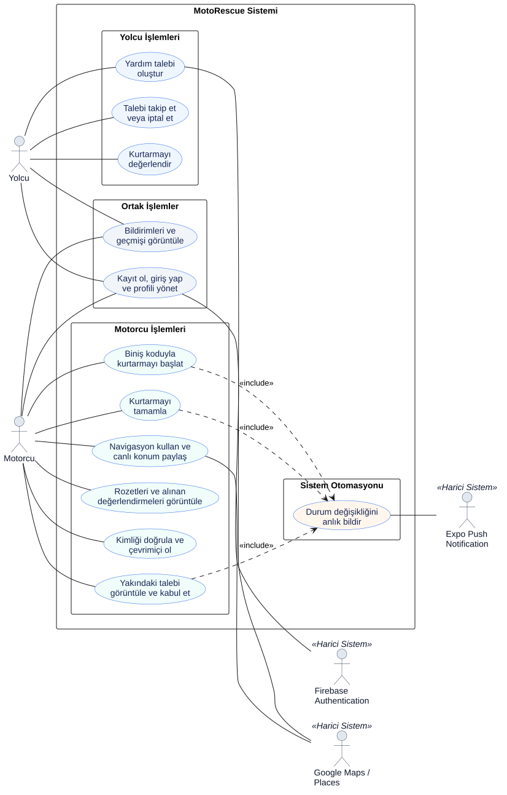
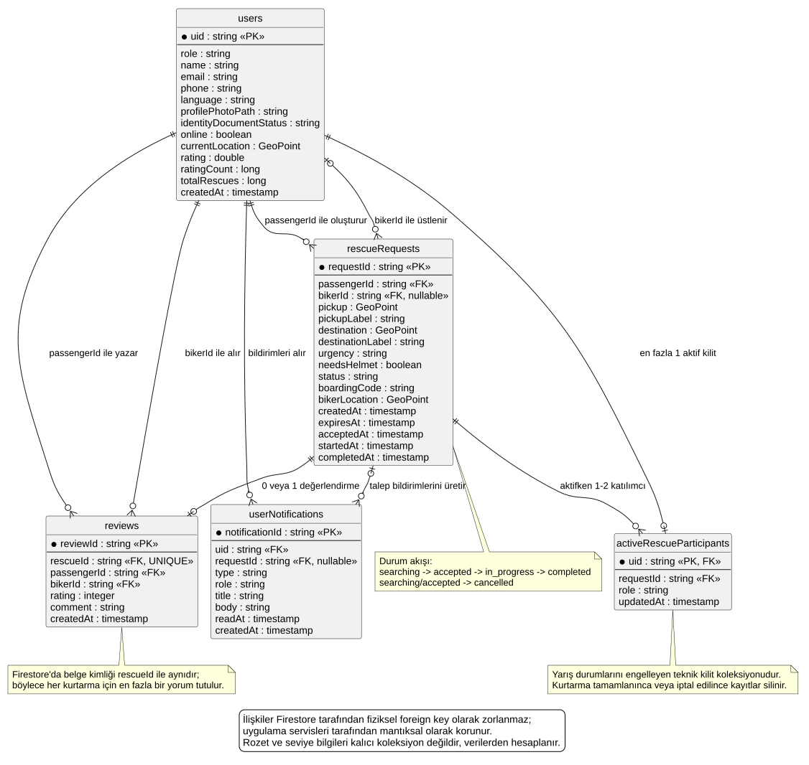

# MotoRescue diyagramları

## Önerilen düzenlenebilir dosya

`MotoRescue-Diagrams.drawio` dosyası diagrams.net/draw.io üzerinde doğrudan açılabilir. Dosya iki
ayrı sayfa içerir: `01 - Use Case` ve `02 - ER Diagram`. Bu sürüm geniş tuval, sade bağlantılar ve
elle düzenlenebilir şekiller kullandığı için staj defteri çalışması için önerilen ana kaynaktır.

Draw.io üzerinde **File → Open From → Device** yoluyla dosyayı seçebilirsin. Düzenleme bittikten
sonra **File → Export as** menüsünden SVG, PNG veya PDF çıktısı alınabilir.

Bu klasörde staj defteri için iki UML diyagramı bulunur:

- `motorescue-use-case.puml`: Yolcu, motorcu ve dış servislerin temel kullanım senaryoları.
- `motorescue-er-diagram.puml`: Firestore koleksiyonları ve aralarındaki mantıksal ilişkiler.

## Use Case diyagramı



## ER diyagramı



Üretilen `.svg` dosyaları kalite kaybı olmadan Word/PDF belgesine eklenebilir. `.png`
dosyaları ise SVG desteklemeyen ortamlarda kullanılabilir. Diyagram metinleri kısa tutulduğu için
A4 yatay sayfa düzeninde daha rahat okunur.

Kaynaklar PlantUML sözdizimindedir. Düzenleme yaptıktan sonra aynı klasörde yeniden üretmek için:

```powershell
java -jar plantuml.jar -charset UTF-8 -tsvg docs/diagrams/*.puml
java -jar plantuml.jar -charset UTF-8 -tpng docs/diagrams/*.puml
```

ER diyagramındaki foreign key ifadeleri Firestore açısından fiziksel kısıt değil, uygulama
servislerinin koruduğu mantıksal referanslardır. Rozetler ayrı koleksiyon olarak saklanmaz;
tamamlanan kurtarmalar ile puan verilerinden hesaplanır.
